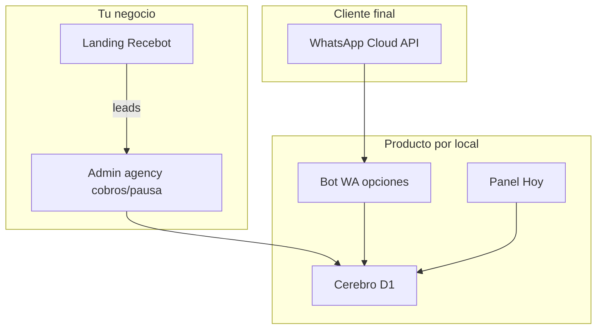

# Plan de producción — Recebot (repo CitaClara)

## Método de trabajo

1. **Plan mode** — se acuerda el alcance.
2. **Aprobación** del plan.
3. **Agent mode** — se implementa solo eso (sin inventar pagos de cita, Booksy, marketing WA ni self-serve).
4. Fuente de verdad: [`AGENTS.md`](../AGENTS.md), [`memory/`](../memory/), [`prompt/`](../prompt/).

La web no es el chat del cliente: es **demo + paneles**. El cliente final habla por **WhatsApp**.

## Capas del producto

| Capa | Para quién | Estado |
|------|------------|--------|
| Landing Recebot (`landing/`) | Captar peluquerías (B2B) | Hecha; falta número WA real |
| Admin agency (`/admin/`) | Tú (cobros 129 €, pausa bot, notas) | Hecho |
| Cerebro + alta por prompt | Cualquier local (fisio / pelu / otro) | Hecho |
| Bot por opciones | Cliente del local | Hecho en `/demo/`; código WA listo |
| Panel Hoy (`/hoy/`) | Dueño del local | Hecho |
| WhatsApp Meta producción | Canal real | Bloqueado por tokens / número |
| Excel / analytics / anti-abuso | Fase posterior | No ahora |

## Orden (y por qué)

1. Motor genérico + admin — sin eso no escalas locales.
2. Piloto fisio en **demo** — pruebas sin Meta.
3. Chat por **opciones** — menos errores que texto libre.
4. **Meta + deploy** — aquí el producto se ve de verdad.
5. Landing con número real — cuando vendas.
6. Después: ingresos / Excel, Calendar, anti-abuso.

## Dónde estamos

- Local: `/demo/` (menú → cita → día → hora → confirmar), `/admin/` (PIN `1234`), `/hoy/` (`fisio-demo` / PIN `4321`).
- Marca pública: **Recebot**; repo: CitaClara.
- Piloto silencioso: cerebro `fisio-demo` (ventas siguen siendo peluquerías Almería).

## Siguiente bloque: go-live

1. Número WhatsApp + secrets Meta en Cloudflare Pages — [`CONECTAR_META.md`](CONECTAR_META.md).
2. `npm run db:migrate:remote` + deploy `app/`.
3. Probar el mismo flujo de opciones en WhatsApp real.
4. `wa.me` en `landing/public/config.js` + deploy landing.

Checklist: [`prompt/CHECKLIST_PRODUCCION.md`](../prompt/CHECKLIST_PRODUCCION.md).

Hasta tener Meta, el plan de producto en **código** está cerrado; falta configuración y deploy.
